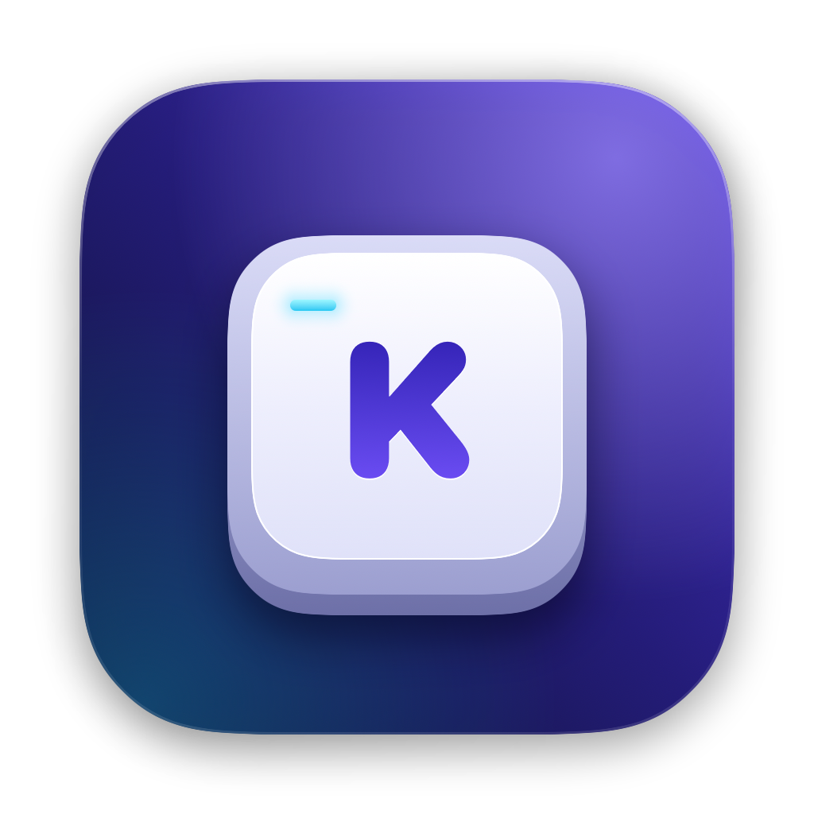
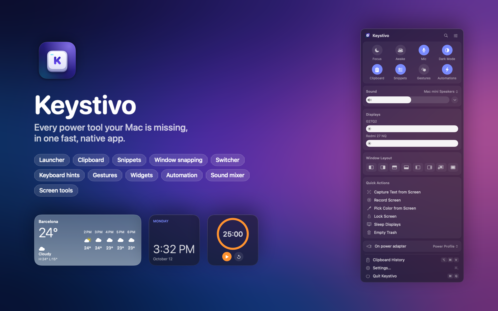
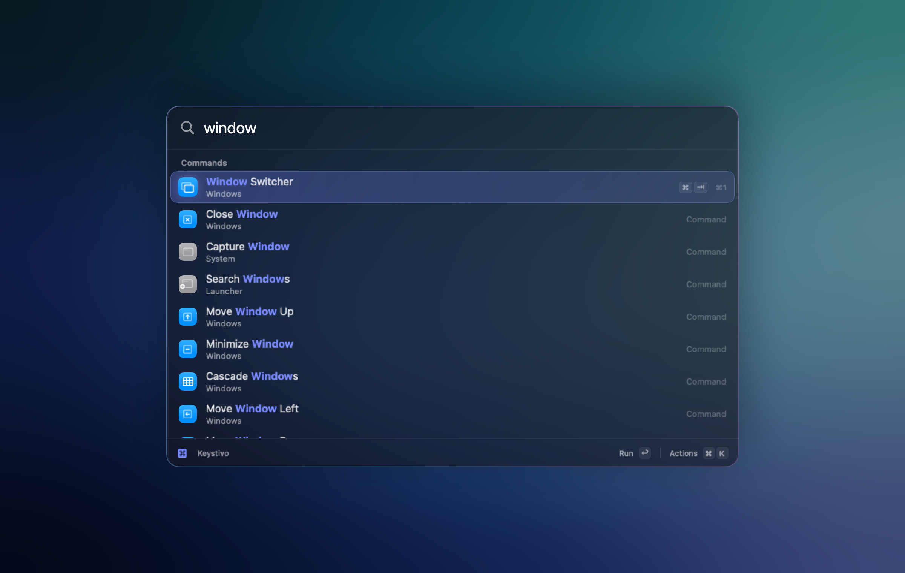
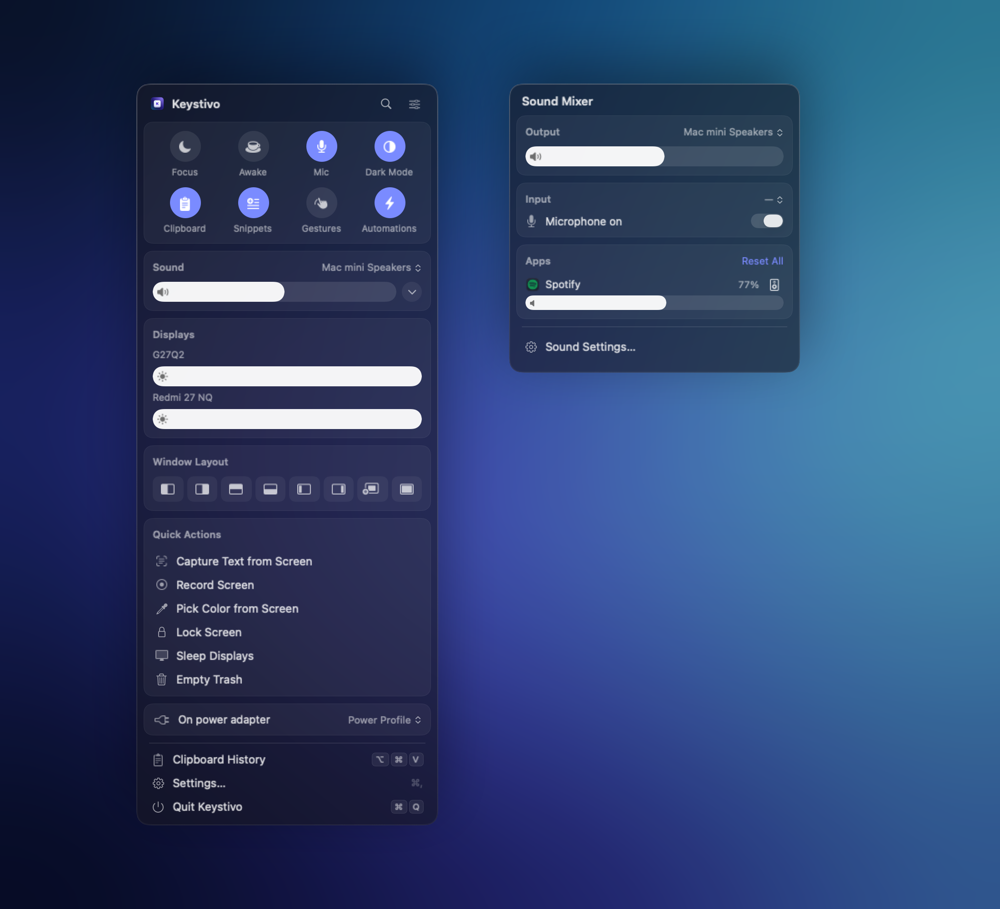
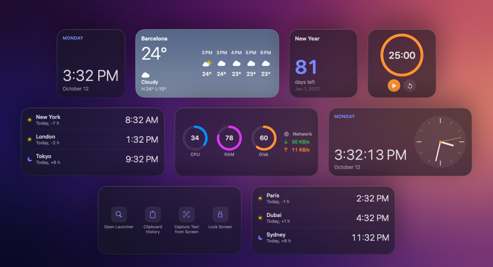
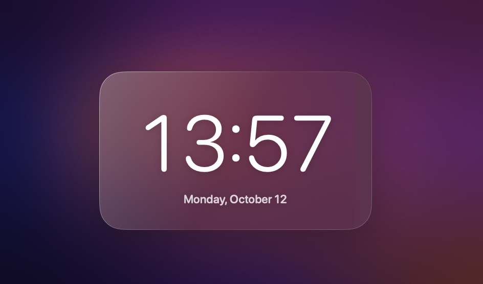

<p align="center">
  
</p>

<h1 align="center">Keystivo</h1>

<p align="center">
  <b>Every power tool your Mac is missing, in one fast, native app.</b><br>
  Launcher · Clipboard · Snippets · Window management · Switcher · Keyboard navigation · Gestures · Widgets · Automation
</p>

<p align="center">
  <a href="https://github.com/emreesahiiinn/Keystivo/releases/latest"></a>
  
  
  
  <a href="https://github.com/emreesahiiinn/Keystivo/actions/workflows/build.yml"></a>
  <a href="LICENSE"></a>
</p>

<p align="center">
  <a href="https://github.com/emreesahiiinn/Keystivo/releases/latest"><b>Download</b></a> ·
  <a href="#features">Features</a> ·
  <a href="#install">Install</a> ·
  <a href="#build-from-source">Build</a> ·
  <a href="README.tr.md">Türkçe</a>
</p>

<p align="center"></p>

Keystivo brings together the utilities power users usually collect one by one: a launcher, clipboard history, text expansion, window snapping and switching, keyboard-driven clicking, trackpad and mouse gestures, menu bar tools, desktop widgets, screen capture and a workflow engine. It's one native Swift app that's light on memory, keeps your data on your Mac and stays out of your way until you call it.

- **Native and fast.** SwiftUI and AppKit, no Electron and no background web views. Features you don't use cost nothing.
- **Private by design.** No account, no telemetry and no cloud. Your clipboard, snippets and settings never leave your Mac.
- **Yours to shape.** Every feature can be switched off, every shortcut remapped, and the menu bar panel rearranged.
- **Speaks your language.** English, Türkçe, Deutsch, Français, Español, Italiano, Português (Brasil), Русский, 简体中文, 繁體中文, 日本語 and 한국어.

## Features

### Launcher


Press <kbd>⌥</kbd> <kbd>Space</kbd> and type. A single search box covers:
- Apps and files
- Every Keystivo command and the open windows
- Menu items of the front app
- Calculator, units, currencies and time zones
- Emoji and symbols, dictionary, quick links, aliases and running processes

Press <kbd>⌘</kbd> <kbd>K</kbd> on any result to see everything you can do with it.

### Menu bar panel and sound mixer


The panel opens from the menu bar on a frosted-glass background. It holds:
- Quick toggles: Focus, Keep Awake, microphone, Dark Mode and more
- Volume, with per-app levels and per-app output devices
- Brightness for external displays
- Window layouts and quick actions

You choose what it shows, in which order and how see-through it is. The sound mixer can also have its own menu bar icon.

### Widgets


Keystivo has eleven live widgets in three sizes:
- Clock and world clocks
- Calendar and countdown
- Weather
- Timer
- System and batteries
- Note, shortcuts and clipboard

Put them on the desktop, below your windows or always on top, or inside the menu bar panel. Drag them anywhere; right-click to resize.

### Screen savers


Eleven clock and ambient designs install as real macOS screen savers. Keystivo can also run a screen saver itself when you're idle, floating over your desktop: clear, dimmed or frosted.

### Everything inside

| Area | What you get |
| --- | --- |
| **Clipboard** | Searchable history of text, links, images, files and colors. Pinning, paste as plain text, ignored apps and one-click clearing. |
| **Snippets** | Type a keyword anywhere to expand text, with placeholders for date, clipboard and cursor. Import from other tools. |
| **Window management** | Snap to halves, thirds and quarters by shortcut or by dragging to screen edges. Move windows across displays and save and restore desk layouts. Drag or resize any window with a modifier key. |
| **Window buttons** | Choose what the red, yellow and green buttons do, such as quit the app, fill the screen or minimize. |
| **Focus follows mouse** | The window under the pointer becomes active. Set separate delays for moving within a display and between displays. |
| **Window switcher** | Switch between individual windows with live previews, most recently used first. Optionally replaces <kbd>⌘</kbd> <kbd>⇥</kbd>. |
| **Keyboard navigation** | Click, search and scroll anything on screen with hint labels, without touching the mouse. |
| **Gestures** | Custom trackpad taps, swipes and tip-taps, plus mouse strokes. Gestures can be limited to specific apps, and you can start from ready-made suggestions. |
| **Mouse and keyboard** | Hyper key, key remapping, side-button actions, and separate scroll direction and smoothing for mouse and trackpad. |
| **Menu bar** | Hide icons behind a separator, and add a system monitor (CPU, memory, network, disk, GPU and sensors) in several widget styles. |
| **Audio** | Per-app volume, mute and output device, quick device switching and reusable audio profiles. |
| **Displays** | Hardware brightness for external monitors over DDC, plus resolutions for every display. |
| **Screen tools** | Capture an area, window or screen. Annotate, pin, grab text and QR codes, pick colors, and record to MP4 or GIF. |
| **Files** | Automatic folder rules, a drag-and-drop shelf and a clean app uninstaller. |
| **Links and browsers** | Open each link in the right browser: work sites in one, personal ones in another. |
| **Automation** | Trigger → condition → actions workflows, built from a library or from scratch. Triggers include hotkeys, apps, time, Wi-Fi, idle, drives, appearance and a `keystivo://` URL scheme. Steps include variables, scripts and Shortcuts. |
| **Plugins** | Add your own commands, written in any scripting language. |
| **Battery** | Charge limit to slow battery aging, plus battery details. |
| **Presentation** | Show your keystrokes, clicks and cursor while presenting or recording. |
| **Profiles** | Switch shortcuts, gestures and settings per context, such as work, home or presenting. |
| **Import and export** | Move your setup between Macs, share parts of it, or roll back to an earlier version. |

## Install

1. Download the latest **Keystivo-x.y.z.dmg** from [Releases](https://github.com/emreesahiiinn/Keystivo/releases/latest).
2. Open it and drag **Keystivo** into **Applications**.
3. Open Keystivo. GitHub builds are not notarized yet, so the first time macOS will say it can't verify the developer. Open **System Settings › Privacy & Security** and click **Open Anyway**, or run:
   ```bash
   xattr -dr com.apple.quarantine /Applications/Keystivo.app
   ```
4. The welcome screen walks you through the permissions Keystivo needs. Accessibility is the main one; Screen Recording is only needed for previews and captures.

**Requirements:** macOS 15 Sequoia or later, Apple silicon or Intel.

> A signed **Mac App Store** edition is planned. Buying it will be the easiest way to support the project. The GitHub version stays free.

## Build from source

You need Xcode 26 or later.

```bash
git clone https://github.com/emreesahiiinn/Keystivo.git
cd Keystivo
make signing-cert   # optional: a local certificate so permissions survive rebuilds
make run            # debug build, then launch
make test           # unit tests for every module
make dmg            # release build packaged as dist/Keystivo-<version>.dmg
```

Most of the code lives in the [`KeystivoKit`](Packages/KeystivoKit) Swift package, one module per area: launcher, clipboard, windows, input, navigation, audio, tools, automation and more. Every string is localized in [`Localizable.xcstrings`](Packages/KeystivoKit/Sources/KeystivoCore/Resources/Localizable.xcstrings); `make l10n-check` verifies that nothing is missing.

See **[docs/DEVELOPMENT.md](docs/DEVELOPMENT.md)** for the architecture, signing and permissions, plugins, localization tools and technical notes.

## Privacy

Keystivo works offline. The only network requests are:
- **Weather widgets:** forecasts from [Open-Meteo](https://open-meteo.com)
- **Currency conversion:** exchange rates from the European Central Bank

Neither request includes anything about you. There are no analytics, crash uploads or accounts.

## Contributing

Bug reports and ideas are welcome in [Issues](https://github.com/emreesahiiinn/Keystivo/issues). For pull requests, keep changes focused, match the surrounding code style, add translations for new strings in all 12 languages, and run `make test` before you push.

## License

Keystivo is free software under the [GNU General Public License v3.0](LICENSE).
